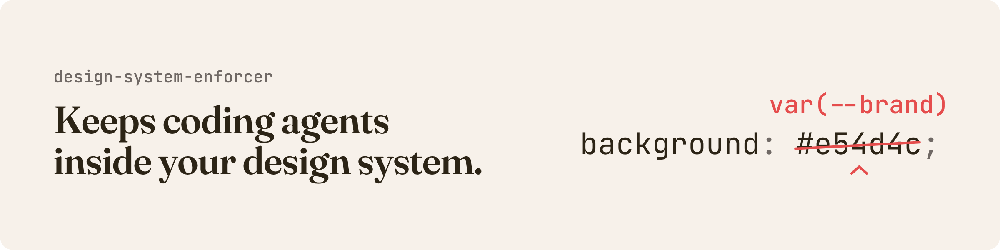
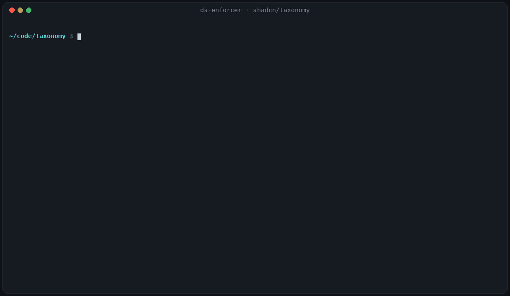

# design-system-enforcer

An MCP server, command line and set of Claude Code hooks that keeps AI coding agents inside your design system.

Before an agent writes UI, the enforcer tells it which tokens and components exist. After it writes, the enforcer checks the edit and hands back the token, class or component to use instead. The same checks run at pre-commit and in CI, with no model involved.

**Start here:** [docs/setup.md](docs/setup.md) walks through installing it, connecting a project, registering the server in Claude Code, Claude Desktop, Codex CLI, Cursor or Gemini CLI, and turning on the edit hook, the commit gate and the GitHub Action.

## Why it exists

Coding agents write UI from their training data, not from your design system. They type hex values, reach for Tailwind's default palette, guess at spacing and hand-roll a button your system already has. A style guide sitting in the repo doesn't stop that. Something has to answer "what should I use?" before the code is written, and "is this right?" after.

The enforcer does both:

- **Before:** `suggest_component` names the component, its props and the only variant values that exist. `list_tokens` finds the token for a role, such as "danger text" or "card padding".
- **After:** `validate_file`, the edit hook and `ds-enforcer check` report what broke the rules, each with the fix.

It was built inside [Workshopr.io](https://workshopr.io), where it guards a PHP and CSS codebase and three SwiftUI apps against agents that write UI every day. A project's settings live in its own `enforcer.config.json`, written by `init`. Workshopr's own config is in [docs/examples/](docs/examples/) as a worked example.



*`init` and `check app` on [shadcn/taxonomy](https://github.com/shadcn-ui/taxonomy) at commit `298a885`. The output is unedited apart from the shortened project path. [`docs/demo/`](docs/demo/) has the transcript and the script that renders it.*

## What it checks

| Rule | Files | Written | Suggested |
|---|---|---|---|
| Hard-coded colour | CSS, PHP, JS, JSX/TSX, Vue, Svelte, Swift | `background: #7d3aed` | `var(--color-brand)`, practically identical |
| Tailwind arbitrary value | class names and `@apply` | `bg-[#7C3AED]`, `p-[13px]` | `bg-brand`, `p-3.5` |
| Tailwind's default palette, when you have your own colours | class names | `text-red-600` | `text-destructive` |
| Hard-coded spacing, radius, shadow, font size or font family | CSS and inline styles | `padding: 13px` | the nearest spacing token |
| Raw control where the system has a component | JSX/TSX, Vue, Svelte, and PHP when your components are functions | `<button>` | `<Button>`, or your `<BaseButton>` |
| Figma and code disagree | token files | `--color-brand` is `#7C3AED` in code and `#7B3AED` in Figma | decide which is right |
| SwiftUI colour literal or theme drift | Swift | a hex colour in a view, or a theme colour that no longer matches its web token | the theme constant |
| Icon drawn under your minimum, off until you switch it on | CSS and `<style>` blocks; inline SVGs and glyph styles in PHP, JS and HTML | `<svg width="16" viewBox="0 0 24 24">` | 24 or larger, or your icon size token |
| House rules, off until you switch them on | everywhere | `color: #000` | the darkest ink token |
| Accessibility, off until you switch it on | markup and CSS | `text-muted-foreground` on `bg-muted` at 4.34:1 | a pair that passes AA |

When no token holds a colour exactly, the suggestion names the nearest one and says how close it is: practically identical, very close, close, or the nearest but clearly different.

A raw element styled with the system's own variants (`<button className={buttonVariants()}>`) counts as using the system, so it isn't flagged. A component's own source folder may use the element it wraps.

To silence one finding, put `ds-lint-disable-line` on the line, or `ds-lint-disable-next-line` on the line above.

## Quick start

```bash
git clone https://github.com/bbulman/design-system-enforcer.git
cd design-system-enforcer
npm install
npm link                       # puts ds-enforcer on your PATH

cd ~/code/your-app
ds-enforcer init               # find your tokens and components, answer a few questions
ds-enforcer check --baseline   # on an existing codebase: record today's findings so only new ones count
ds-enforcer check              # run every check

# Give Claude Code the tools, from your app's folder
claude mcp add design-system-enforcer -- node /path/to/design-system-enforcer/index.js
```

You need Node 20.11 or later. It isn't on the npm registry: install it from GitHub, as [docs/setup.md](docs/setup.md#1-install-it) shows. Don't run `npm install design-system-enforcer`, because that name belongs to a different package.

The repository is also a Claude Code plugin. `.claude-plugin/plugin.json` registers the MCP server, and `hooks/hooks.json` registers the edit hook and the end-of-turn report, both through `${CLAUDE_PLUGIN_ROOT}`, so nothing machine-specific is written into your project.

## Connecting your design system

`init` scans the project and offers what it finds as a numbered menu, with its picks ticked. It reads:

- **CSS variables:** custom properties, including Tailwind v4 `@theme` blocks, shadcn's bare HSL channels (`--primary: 222 47% 11%`) and `oklch()` colours.
- **W3C design tokens:** DTCG JSON (`$value`, `$type`, aliases like `{color.brand}`) and Style Dictionary's `value` format.
- **Figma variables:** the JSON from Figma's variables API (`/v1/files/:key/variables/local`), in each collection's default mode. A variable takes its name from its Web code syntax when the designer set one, otherwise from its path, so `color/brand` becomes `--color-brand`.
- **Components:** React, Vue and Svelte folders. It starts from the folder shadcn's `components.json` names, then looks for folders called `components` or `ui`. For each component it records the props, `cva` variants and defaults, string-union props (`size?: 'sm' | 'md'`), Vue's `defineProps`, Svelte's `$props()` and `export let`, and the doc comment.
- **SwiftUI themes:** Swift files that declare a set of colours, grouped by Xcode project or Swift package.

It detects Tailwind v3 or v4 from your dependencies. Then it asks what `1rem` equals in pixels, whether to switch on the two house rules (no pure black, no pure white backgrounds), and whether to add the edit hook. You can add paths the scan missed. `--yes` takes every default, and answers can be piped in, one per line.

It writes:

| File | What it is |
|---|---|
| `enforcer.config.json` | Your settings and the connected sources, marked `"configVersion": 3` |
| `.ds-enforcer/catalog.json` | Generated: every token and component, in the format the tools read |
| `.ds-enforcer/tokens.css` | Generated: the tokens as the checks see them, colours as hex with the original in a comment |
| `.ds-enforcer/native.json` | Generated when SwiftUI themes are connected: the apps and their theme files |
| `.ds-enforcer/synonyms.json` | Yours to edit: the words people use for things, such as `"Dialog": ["modal", "popup"]`. Starter words are added for common components, and your entries are never changed |

The generated files rebuild themselves when a connected source changes. Commit them, or ignore them and run `ds-enforcer sync` after a clone. `init` never overwrites an `enforcer.config.json` you wrote by hand unless you say so.

**From Claude instead of the terminal:** on a project that isn't connected, every tool tells the agent to call `init`. It scans, asks you the same questions in chat, connects, and the tools work straight away with no restart.

## MCP tools

| Tool | What it does |
|---|---|
| `init` | Detect sources, connect them (with the edit hook if you want it), or resync |
| `suggest_component` | The component for a description, with its import, props and the only variant values that exist |
| `list_components` | Every component with its usage and summary |
| `list_tokens` | Tokens by category, or the best matches for a role |
| `validate_file` | Every finding in a file, with line, severity and fix; with a baseline, which ones are new |
| `check_snippet` | The same for code not yet in a file: `css`, `php`, `js`, `jsx`, `tsx`, `vue`, `svelte` or `swift` |
| `audit_page` | A full report for one file: counts by severity and type, what can be fixed automatically, every finding |
| `fix_file` | Applies the swaps with exactly one right answer: a colour, spacing or radius value that matches a token. Has a dry run. Never edits Swift |
| `report` | Writes `design-system-report.md`, a checklist with one box per new finding, each marked auto or for Claude |
| `apply_report` | Works through the ticked boxes: applies the auto fixes, hands the rest to Claude, re-checks and marks them done |
| `a11y_review` | The accessibility review of a file or snippet, or of the design system's own colour pairs |
| `native_apps` | For SwiftUI apps: each app's theme files and current drift, with any build commands the manifest lists |

With the optional component gate switched on, four more are listed: `consult_ui`, `record_case`, `apply_review` and `scan_components`. See [the component gate](#the-component-gate-optional).

## Command line

```text
ds-enforcer                   start the MCP server (what Claude Code runs)
ds-enforcer init   [--root <dir>] [--yes]
ds-enforcer sync   [--root <dir>]
ds-enforcer check  [paths...] [--baseline] [--only <rule,...>] [--all] [--a11y]
                   [--since <ref>] [--files-from <file>] [--commit]
                   [--format text|json|github|sarif] [--min low|medium|high]
                   [--fail-on low|medium|high|never] [--root <dir>]
ds-enforcer report [paths...] [--out <file>] [--min low|medium|high] [--a11y]
ds-enforcer apply  [--report <file>] [--tick R1,R4|auto|all] [--accept-rest]
ds-enforcer staged            the pre-commit gate, on the staged copy of each file
ds-enforcer hook              the edit hook (Claude Code PostToolUse, payload on stdin)
ds-enforcer stop-hook         the end-of-turn report (Claude Code Stop, payload on stdin)
```

`check` with no paths checks the whole project. Paths are relative to the folder you're in, and the project is found the way git finds `.git`. `--all` ignores the baseline. `--only` limits the run to some rules, and with `--baseline` it re-records only theirs.

`check` exits `1` when it finds a new finding at or above `--fail-on` (default `high`), and `2` when the project isn't connected, a path doesn't exist or `--since` can't be compared. With `--commit`, it also exits `2` on a config older than `"configVersion": 3`, rather than run with rules off.

## Checking every edit

Say yes to the hook in `init`, and after Claude edits or writes a file the enforcer checks it. New findings at or above `medium` go straight back to Claude, which fixes them in its next step. Anything else stays silent. Set `hookMin` to `high` or `low` to change the cut-off.

The hook never blocks work it can't judge: an unconnected project, a file type it doesn't check, a file outside the project, or an error of its own all let the edit through.

When Claude finishes a turn, a second hook refreshes `design-system-report.md` for the files edited that session and shows the list if anything is left to fix. Tick the boxes you want and say "apply the design system report", or run `ds-enforcer apply`. The enforcer makes the auto swaps itself, Claude makes the rest, and the enforcer re-checks each one before marking it done. Set `autoReport` to `false` to turn the report off.

`init` adds both hooks to `.claude/settings.local.json`, your personal settings, because the command holds this machine's path to the enforcer. Claude Code normally picks them up on its own; if `/hooks` doesn't list them, start a new session.

## The checklist report

`ds-enforcer report`, or asking Claude for "a design system report", writes `design-system-report.md`: every new finding as a checkbox, grouped by file, each marked **auto** (a swap with exactly one right answer) or **Claude** (it needs judgment).

```markdown
## src/app/page.tsx (2)

- [ ] **R1** · line 6 · high · Arbitrary colour bg-[#7C3AED] → `bg-[#7C3AED]` → `bg-brand` · *auto*
- [ ] **R2** · line 9 · medium · Raw <button> where the design system has <Button> → Use <Button> (list_components shows its props and variants) · *Claude*
```

Tick the boxes you want, in the file or from chat ("tick R2 and all auto"), then run `ds-enforcer apply` or ask Claude to "apply the design system report". The enforcer makes the auto swaps itself, hands the rest to Claude, re-checks every file and marks each box as fixed, for Claude or still there. Run `apply` again after Claude's edits to verify them. Unticked items are left alone, and `apply --accept-rest` records them in the baseline so they stop coming back. Each line ends with an HTML comment holding its data, which doesn't show when the Markdown is rendered.

In `enforcer.config.json`, `"reportMin": "medium"` lists less, and `"openReport": true` also opens the file in your default app when the end-of-turn report has something new.

## Checking every commit

The simplest gate is a pre-commit hook that checks the staged files:

```sh
files=$(git diff --cached --name-only --diff-filter=ACM -- '*.css' '*.js' '*.jsx' '*.ts' '*.tsx' '*.vue' '*.svelte' '*.php' '*.swift')
[ -z "$files" ] || ds-enforcer check $files
```

`ds-enforcer staged` is stricter. It checks the staged copy of each file, not the working tree: it exports what's being committed to a temporary folder with `git checkout-index`, runs the rules there at `--fail-on medium` against your baseline, runs any checks of your own listed under `staged.checks` in `enforcer.config.json`, and removes the folder. Unfinished or untracked files can't block a commit, and nothing left unstaged slips through. Its own rules cover staged `.php`, `.css`, `.js`, `.html` and `.swift` files.

The gate reads one config for the whole run: the staged copy of `enforcer.config.json` when it has `"configVersion": 3`, otherwise the working-tree copy, with a note. It stops the commit with exit 2 rather than check against a config it can't read or one older than version 3. [docs/configuration.md](docs/configuration.md#which-config-a-commit-is-checked-against) has each case.

## Pull requests

`ds-enforcer check --since <base> --format github` checks only the files a pull request changed and prints GitHub annotations, which show up on the diff. This repository is also a GitHub Action that runs it:

```yaml
# .github/workflows/design-system.yml
name: Design system
on: pull_request
jobs:
  enforce:
    runs-on: ubuntu-latest
    steps:
      - uses: actions/checkout@v4
        with:
          fetch-depth: 0   # the base commit is needed to see what changed
      - uses: bbulman/design-system-enforcer@v1
        with:
          fail-on: high
```

The Action takes `fail-on`, `paths` (space-separated, default the whole project), `working-directory` (where `enforcer.config.json` lives) and `summary`. When anything is found, it also adds [the checklist report](#the-checklist-report) for the changed files to the job summary; set `summary: 'false'` to leave it out. `--format sarif` writes SARIF 2.1.0 for GitHub code scanning and other tools.

## The baseline ratchet

A codebase that's been around a while has findings on day one. Run `ds-enforcer check --baseline` once and commit `.ds-enforcer/baseline.json`. From then on `check`, the edit hook, the commit gate and pull-request annotations report only what's new, and `validate_file` marks the old findings as existing.

Findings are matched by file, rule and value, not by line number, so moving code around never makes an old finding look new. The counts make it a ratchet: a file with three baselined `#fff`s may keep three, not grow a fourth. When you fix old findings, run `--baseline` again to lock the lower count in.

## Accessibility, Figma drift and SwiftUI themes

**Accessibility.** `a11y_review`, `check --a11y`, or `"a11y": true` in the config to make it part of every check and the hook. It reviews what the code itself shows:

- **Names:** images without `alt`, buttons and links that hold only an icon and no label, form fields with no label. A placeholder isn't a label.
- **Keyboard:** clickable `div`s and `span`s with no role, `tabIndex` or key handler; positive `tabIndex`; `aria-hidden` on focusable elements; autofocus.
- **Structure:** skipped heading levels, links without `href`, `<html>` without `lang`.
- **Contrast:** the WCAG ratio for text and background colours used together, from Tailwind classes on one element, inline styles and CSS rules, against AA (4.5:1, or 3:1 for large text).

With `tokens: true`, `a11y_review` audits the design system's own colour pairs (each token with its `-foreground`, and `background` with `foreground`) before anyone uses them. On shadcn's default theme it finds `muted-foreground` on `muted` at 4.34:1, just under AA.

**Figma drift.** Connect a Figma variables export alongside your code tokens, and every token both define is compared. A difference becomes a `token-drift` finding on the line that declares the token in code, so it shows up in `check`, the hook and pull requests like any other, and a baseline can hold the ones your team has accepted. `init` also reports how many Figma variables have no code token at all.

**SwiftUI themes.** For a product with SwiftUI apps beside the web, the enforcer checks that each app's theme colours still match the web tokens they mirror, and that views use theme constants instead of colour literals. A trailing `// --token` comment on a theme constant names the token it mirrors, so a changed value reads as drift rather than an unknown colour. Pure black and brand fonts follow your house rules and `nativeExtras`, and `rules.pureBlack.native` switches the Swift pure-black check on or off apart from the web one. `native_apps` shows each app with a live count of its findings.

## The component gate (optional)

The checks above catch a hard-coded value. They don't catch an agent that hand-builds a status badge with its own classes when the system already has one. The component gate is for that. It's off by default, and with it off its tools aren't listed, its commands say it's off and its hooks let everything through.

With `componentGate.enabled` on:

- **Before a write.** A write that adds markup to a gated file (the types in `componentGate.files.gate`, `.php` and `.css` by default, minus the paths in `componentGate.skip`) is refused until the session has consulted `consult_ui` on that file. A change to wording or logic passes. Two refusals per file are the most it gives: the third attempt goes through and is recorded, so an agent that can't consult never stalls a build.
- **The consult.** `consult_ui` takes the file and one plain-words line per UI piece. For each piece it lists up to five components that could build it, with an example call and when to use it, or says nothing fits.
- **Cases.** When an agent keeps its own markup, builds a piece nothing fits, or keeps markup a lookalike finding flagged, it records a case with `record_case`. A lookalike is a class ending in a component word, such as `status-badge`, or a component's own root class written by hand.
- **Before finishing.** At Stop and SubagentStop, each agent has to have built every piece it declared with a candidate, or recorded a case for it. Anything left blocks that agent once, with the list.
- **Review.** A person decides each case: use the component, keep the agent's version, or turn a recurring pattern into a new component. `apply_review` carries the decisions out and re-checks the files. `scan_components` ranks bespoke patterns that keep coming back as suggestions for new components.

The enforcer doesn't ship the review page. It keeps the queue in `.ds-enforcer/review.json` and the suggestions in `.ds-enforcer/suggestions.json`, and your project supplies a page that shows them and records the decisions. Workshopr's page runs only on its local dev server and never touches a database. The gate's hooks aren't in the plugin either: you wire `gate`, `gate-post` and `finish` into your Claude Code settings yourself. [docs/configuration.md](docs/configuration.md#the-component-gate) has the settings and the wiring.

## Configuration

`init` writes `enforcer.config.json` for you. The settings you're most likely to change:

| Key | Default | What it's for |
|---|---|---|
| `configVersion` | none | The config format; `init` writes `3`. Below it, `check --commit` and `staged` stop with exit 2 and other commands warn |
| `sources` | `[]` | What `init` connected: CSS, DTCG, Figma, React, Vue, Svelte or Swift paths |
| `framework` | `css` | `react`, `vue` or `svelte` turns on the markup checks for those files |
| `tailwind` | detected | `"v3"`, `"v4"` or `false` |
| `rootPx` | `16` | What `1rem` equals, for matching rem values to tokens |
| `rules.pureBlack`, `rules.pureWhite` | off | The two house rules |
| `iconSize` | off | The small-icon rule: the smallest an icon may be drawn, the size token to suggest, and sizes retired for icons |
| `a11y` | `false` | The accessibility review in every check and the hook |
| `hookMin` | `medium` | The lowest severity the edit hook reports |
| `baseline` | `.ds-enforcer/baseline.json` | Where the baseline lives |
| `components.*` | none | How a project names components written as functions, such as PHP helpers |
| `text.*` | the generic text | The tool descriptions and advice in your project's own words |
| `staged` | no checks | Your own checks for the commit gate |
| `componentGate` | off | The optional component gate |

Every setting, with its default, is in [docs/configuration.md](docs/configuration.md).

## Safety

- `validate_file`, `audit_page`, `a11y_review` and `fix_file` read, and `fix_file` writes, only inside the project. Absolute paths elsewhere and `..` escapes are refused.
- The checklist report, and the files its items name, are written and read only where their real path is inside the project, so a symlink in the project can't lead out of it.
- `fix_file` only applies swaps with exactly one right answer, and never touches Swift.
- The MCP server makes no network calls. It runs no other program, except `git ls-files` when the component gate's `scan_components` runs. Started through `bin/ds-enforcer.mjs` in a fresh clone, it first installs its one dependency with `npm ci`.
- `init` writes only `enforcer.config.json`, `.ds-enforcer/` and, if you say yes, the two hook entries in `.claude/settings.local.json`, keeping everything else there.
- No hook calls a model.

## What it can't see

It reads code. It never renders the page. So:

- Focus order and visibility, target size, zoom and what a screen reader announces still need the browser's accessibility tree.
- Contrast is measured only for solid colours. A class with an opacity modifier (`bg-black/50`) or a translucent colour is skipped, since what shows through is unknown. Only the base state is checked, not `hover:` or `dark:`.
- A class name built at runtime, or a style that arrives through the cascade from a file it wasn't given, is invisible to it.
- Tailwind v3's `tailwind.config.js` isn't read. Class names are matched to your tokens by name, so `--primary` is `bg-primary`. Tailwind v4's `@theme` is read directly.
- DTCG typography composites are skipped, since they have no single CSS value.
- Components are read with patterns, not a compiler, so unusual export styles can be missed.
- `ds-enforcer staged` checks `.php`, `.css`, `.js`, `.html` and `.swift`. For React, Vue and Svelte files, use the `check` pre-commit hook above.
- The GitHub Action has been run locally, not yet on GitHub itself.

## License

MIT. Made by [Workshopr.io](https://workshopr.io).
